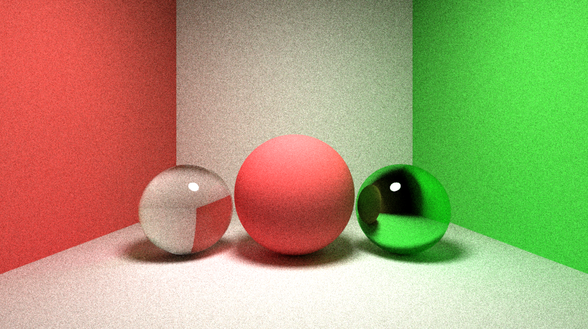
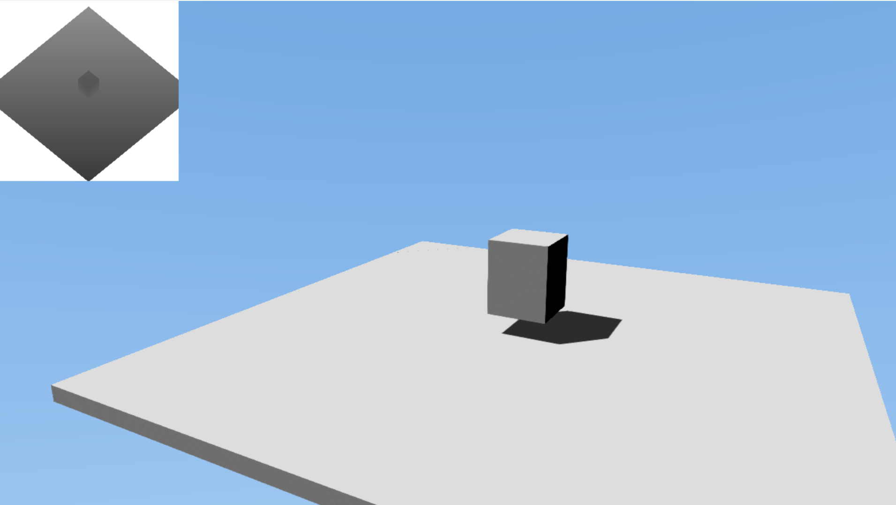

# DX-NGen
Building a fun, multi-purpose toy rendering engine in DX12 to get familiar with the API and to refine my compute skills.

What was originally special-purposed towards software path-tracing, now turned into an emerging DX12 graphics engine.

Features implemented so far:
- Automatic root-signature creation and resource binding system
- Abstracted task system to draw geometry and dispatch compute shaders in less than ~20 lines of code. Still working on it.
- PCF-filtered shadow maps using hardware-filtering
- FXAA compute-shader post-processing
- A path-tracer. Just for fun, but on a completely separate scene. Press "m" to toggle.

*Software path-traced result in compute-shader*

*Rasterized scene with shadow-map debug view*

Currently no build instructions yet, but note that this is a MSVC/Visual Studio solution project.